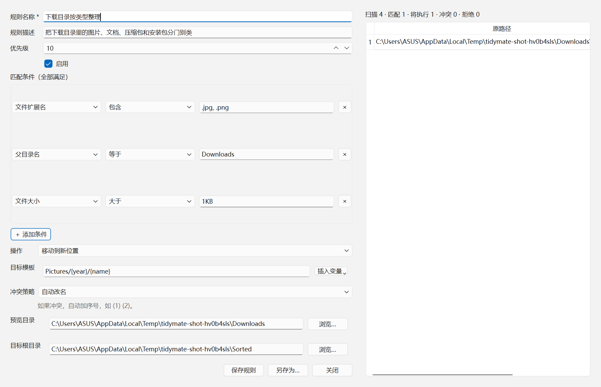
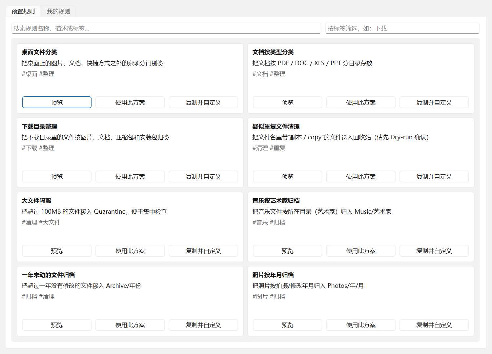

# 阶段 10 验证报告：可视化规则构建器 + 预置规则库（子阶段 1-2）

- 日期：2026-10-21
- 范围：预置规则文件与打包、CLI 规则命令、GUI 可视化编辑器与规则库
- 结论：子阶段 1、2 完成；子阶段 3（高级 YAML 编辑器与双向切换）**未开始**，按约定等验收后再做。

## 1. 预置规则库（8 个）

```text
presets/
├── downloads-cleanup.yaml        下载目录整理（4 条规则）
├── photos-by-year.yaml           照片按年月归档
├── desktop-tidy.yaml             桌面文件分类（3 条规则）
├── large-files-quarantine.yaml   大文件隔离（>=100MB）
├── duplicates-to-trash.yaml      疑似重复文件清理（副本/copy）
├── music-collection.yaml         音乐按艺术家归档
├── documents-by-type.yaml        文档按类型分类
└── old-files-archive.yaml        一年未动的文件归档
```

每个文件都有元数据注释头（`# name:` / `description` / `tags` / `icon`），正文是标准
YAML，由同一个严格 loader 解析。8 个文件全部可加载（`test_all_eight_presets_exist_and_load`）。

真实预览（沙箱 `Downloads/` 下 4 个文件）：

```text
$ python -m tidymate_cli use-preset downloads-cleanup <sandbox>\Downloads -o <sandbox>\Sorted --yes
scanned=4 matched=4 execute=4 skip=0 reject=0 conflicts=0
   1 execute move downloads-images    a.jpg -> Pictures\2026\a.jpg
   2 execute move downloads-documents b.pdf -> Documents\2026\b.pdf
   3 execute move downloads-archives  c.zip -> Archives\2026\c.zip
   4 execute move downloads-installers d.exe -> Installers\d.exe
```

## 2. GUI 可视化构建器



- 左 60%：名称/描述/优先级/启用、条件表（字段 + 运算符 + 值，可增删行）、操作、模板
  （带「插入变量」菜单，变量来自 loader 白名单）、冲突策略与说明；
- 右 40%：实时预览表（原路径 → 新路径、冲突标红、拒绝标黄）与统计；
- 编辑后 **300ms** 重建预览（`QTimer` single-shot），预览走真实 `build_plan`，不是模拟；
- 保存写 `%LOCALAPPDATA%\TidyMate\rules\<规则名>.yaml`，含元数据注释；另存为可选路径。



- 卡片网格、搜索框、标签筛选；
- 每张卡片：预览（只读 YAML）、使用此方案（复制到用户目录并打开编辑器）、
  复制并自定义（加「副本」后缀）；
- 「我的规则」标签页：列出用户规则，支持复制、导出、删除（删除走回收站）。

## 3. 规则模型的扩展（表单需要、文本格式原来没有）

| 字段 | 用途 | 测试 |
| --- | --- | --- |
| `parent` / `parent_contains` | 父目录名等于 / 包含 | `test_parent_*` |
| `path_contains` | 路径包含（大小写不敏感） | `test_path_contains_is_case_insensitive` |
| `size_max` | 大小上限（范围） | `test_size_range_uses_two_bounds` |
| `mtime_before` | 时间上限（之间） | `test_mtime_between_uses_two_bounds` |
| `ext_exclude` | 扩展名不包含 | `test_not_in_becomes_ext_exclude` |

全部向后兼容：老规则文件不需要改动。

## 4. CLI

```text
$ python -m tidymate_cli list-presets
id                           名称                 标签
desktop-tidy                 桌面文件分类           桌面, 整理
...
$ python -m tidymate_cli list-rules
规则目录：C:\Users\<user>\AppData\Local\TidyMate\rules
downloads-cleanup.yaml        下载目录整理
...
$ python -m tidymate_cli use-preset downloads-cleanup <dir> -o <out>
```

首次运行任何命令时，8 个预置会以副本形式复制到用户规则目录（已存在则跳过）。

## 5. 验收标准对照

| # | 标准 | 状态 |
| --- | --- | --- |
| 1 | 非程序员可创建「.jpg 按年份」规则 | 流程可用；**真人测试未做**（需要你找一位没见过的用户） |
| 2 | 修改条件后 300ms 内预览更新 | ✅ `QTimer(300)` + `test_editor_preview_updates_within_debounce` |
| 3 | 可视化 ↔ 高级模式双向切换不丢数据 | ❌ **子阶段 3 未做** |
| 4 | 8 个预置全部可加载 | ✅ |
| 5 | 不回归：572 测试 + 覆盖率 ≥ 90% | ✅ `620 passed, 90.09%` |
| 6 | 现有 CLI 命令不受影响 | ✅ 原有测试全过 |

## 6. 未完成与已知限制

1. **高级模式（YAML 编辑器、行号、高亮、双向切换）**：子阶段 3，尚未开始。
2. 条件的「值」目前是文本框（提示如 `10MB`、`2026-01-01`、`30（天）`），
   **没有**日期选择器和 KB/MB/GB 下拉；功能等价，体验待打磨。
3. 「使用此方案」会复制文件并打开编辑器，但由于没有 YAML→表单的反向解析，
   **表单里只预填名称/描述**，规则正文仍是复制出来的原文件；编辑并保存后会以表单内容
   覆盖该文件。反向解析随子阶段 3 一起做。
4. 「试运行」按钮未接到扫描页；编辑器内的预览已经是真实 dry-run。
5. 预置规则只覆盖现有条件能力；`duplicates-to-trash` 是「文件名疑似重复」，不是内容哈希去重。
6. 打包：`presets/` 已通过 PyInstaller `--add-data` 进入 bundle，但本阶段的 MSI 尚未重新构建。

## 7. 复现

```powershell
python -m pytest -q
python -m tidymate_cli list-presets
python -m tidymate_cli use-preset downloads-cleanup <dir> -o <out> --yes
python scripts/render_rule_ui_shot.py   # 重新生成两张截图
```
